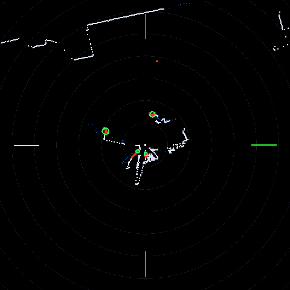
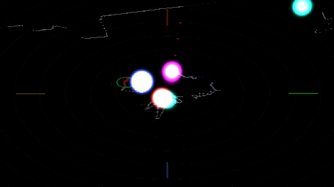

# RPLIDAR S2E w TouchDesignerze

Ethernetowy lidar 2D Slamteca zamknięty w jednym `.tox`: skan 1024 kubełków,
30 m zasięgu, nauka tła, wykrywanie i śledzenie ludzi, OSC. Cały kod siedzi
w DAT-ach komponentu i korzysta tylko z `socket` i `numpy`.

| Widok z góry | Demo |
|---|---|
|  |  |

Biały – skan na żywo, niebieski – nauczone tło, czerwony – obiekty,
zielone kółka – śledzone bloby.

Wersja na USB (A1 / A2 / A3) jest osobno: [rplidar-windows](https://github.com/technofania/rplidar-windows).

## Wymagania

- Windows 10/11
- RPLIDAR S2E z zasilaczem z zestawu — Ethernet nie zasila czujnika, to nie PoE
- kabel Ethernet i gniazdo LAN w komputerze albo przejściówka USB-Ethernet
- [TouchDesigner](https://derivative.ca/download) 2022.20000+ (testowane na 2025.32460)
- prawa administratora jednorazowo, przy dodawaniu adresu IP karcie

## Start

S2E ma na stałe adres **192.168.11.2** i o nic nie prosi: nie pyta o DHCP, nie rozgłasza
się. Komputer musi mieć własny adres w tej samej podsieci. Instalator **dodaje**
`192.168.11.5` obok istniejących adresów, więc Wi-Fi, internet i DHCP chodzą dalej,
a cofnięcie to usunięcie jednego adresu.

1. **Code → Download ZIP**, rozpakuj.
2. Zasilacz do gniazdka, kabel Ethernet do komputera. Głowica powinna ruszyć.
3. `INSTALUJ.bat` — UAC wyskakuje raz, przy kroku 1/4. Dalej: szukanie czujnika,
   sprawdzenie TD, skróty na pulpicie.
4. Otwórz `td\RPLidarS2E.toe`.
5. Wyjdź z zasięgu czujnika i pulsnij **Naucz tło** (3 s pustego pomieszczenia).
   Dopóki tego nie zrobisz, obiektem jest każda ściana.

Ręcznie, bez instalatora: Ustawienia → Sieć i internet → Ethernet → **Edytuj** przy
„Przypisanie IP" → Ręcznie → IPv4 → adres `192.168.11.5`, maska `255.255.255.0`,
bez bramy i DNS.

Stan sterownika na żywo: DAT `status` w komponencie.

```
DZIALA  adres 192.168.11.2  tryb Sensitivity (30 m)
obroty: 606 rpm   obrotow: 118   probek: 374112   bledow: 0
czujnik: RPLIDAR S2E, firmware 1.02, hardware 18
zdrowie czujnika: OK (kod 0)
```

Tło siedzi w DAT-cie `bg_data` i zapisuje się razem z projektem. Po przestawieniu
czujnika albo przemeblowaniu — naucz od nowa.

## Komponent `s2e`

`td\rplidar_s2e.tox` jest samowystarczalny, przeciągnij go do swojego projektu.

### Wyjścia

| Operator | Zawartość |
|---|---|
| `scan` | CHOP, kanał `dist`: 1024 kubełki odległości w mm, kubełek `k` = kąt `k · 360/1024`, `0` = brak odbicia |
| `objects` | CHOP, próbka na slot: `active id x y dist angle width age speed`. `x`, `y` w metrach, `x` w prawo, `y` do przodu czujnika |
| `info` | CHOP: `ok rpm revs samples errors objects points background learning` |
| `view` | TOP 720×720, widok z góry |
| `cloud` | TOP 1024×1 RGBA32F: `R`=x[m] `G`=y[m] `B`=odległość[m] `A`=1 odbicie / 2 obiekt |
| `objdata` | TOP *Slots*×1 RGBA32F: `R`=x[m] `G`=y[m] `B`=szerokość[m] `A`=1 gdy slot zajęty |
| `status` | DAT ze stanem sterownika |
| `oscout` | wysyła kanały `objects` po OSC, gdy zaznaczysz *Wysyłaj OSC*; adresy = nazwy kanałów |

### Parametry — Lidar

| Parametr | Działanie |
|---|---|
| **Active** | wyłączenie zamyka połączenie |
| **Adres czujnika** | `auto` albo wpisany na sztywno, np. `192.168.11.2` |
| **Znajdź czujnik** | przeszukuje sensowne adresy i wpisuje znaleziony |
| **Tryb skanu** | `auto` bierze tryb zalecany przez czujnik, na S2E *Sensitivity* |
| **Restart sterownika** | zamyka i otwiera połączenie od nowa |

### Parametry — Tlo i obiekty

| Parametr | Działanie |
|---|---|
| **Naucz tło** / **Wyczyść tło** | 3 s nauki pustego pomieszczenia / powrót do stanu bez tła |
| **Używaj tła** | wyłączone = obiektem jest wszystko w zasięgu |
| **Margines tła** | o ile mm bliżej niż tło musi coś być, żeby liczyło się jako nowe. Za mało → ściany migoczą, za dużo → człowiek przy ścianie znika |
| **Zasięg min / max** | odcina odbicia od obudowy i z drugiego końca sali |
| **Min. / max. szerokość obiektu** | w kubełkach; min 6 odsiewa zgubione próbki, max 160 odsiewa całą ścianę |
| **Dopuszczalna dziura** | ile pustych kubełków wolno przeskoczyć, sklejając jeden obiekt |
| **Głębokość przedniej powierzchni** | liczy się tylko to, co najbliżej; inaczej środek obiektu wędruje po ramieniu |

**Sledzenie**: `Slots` (ile obiektów naraz), `Max. przeskok` (ile metrów obiekt może
przeskoczyć i wciąż być sobą), `Zwolnienie numeru po`, `Wygładzanie`.
**Widok**: zasięg, rysowanie tła i kółek. **OSC**: adres i port odbiorcy.

### Tryby skanu

Czujnik sam podaje listę swoich trybów, `sprawdz-lidar.bat` ją wypisuje.
Firmware 1.02 ma cztery:

| Tryb | Zasięg | Format ramki | Obsługiwany |
|---|---|---|---|
| Standard | 16 m | 5 B na próbkę | tak, awaryjnie — jeden datagram na próbkę |
| DenseBoost | 30 m | kapsuła 84 B, 40 próbek | tak |
| UltraDense | 30 m | kapsuła 165 B | nie |
| Sensitivity | 30 m | ramka HQ 781 B, 96 próbek | tak, domyślny i zalecany przez czujnik |

Zostaw `auto`. Sensitivity daje 30 m, 32 000 próbek/s i kąt oraz odległość wprost
w każdej próbce.

## Parametry czujnika

Zmierzone na firmware 1.02, tryb Sensitivity:

| | |
|---|---|
| obroty głowicy | 10,1 /s (606 rpm), nie do zmiany |
| próbek na sekundę | 32 000 |
| próbek na obrót | ~3170, czyli 0,11° między próbkami |
| datagramów na sekundę | 333 po 781 B, ~20 Mbit/s ciągłego UDP |
| zasięg | 0,1 – 30 m |

Komenda sterowania obrotami (`0xA8`) na tym egzemplarzu nic nie robi.
Kubełków jest 1024 (0,35°), czyli średnio trzy próbki na kubełek. Przy 2048 część
kubełków byłaby pusta, a `scan` i `cloud` urosłyby bez zysku.

Dla porównania: A2 daje 1,2° fabrycznie, 0,67° po zwolnieniu silnika.

## Zastosowania

- Pozycje ludzi: `objects` → `x`, `y`; `info/objects` = ilu w kadrze.
- Duże przestrzenie: 30 m zasięgu obsłuży całą salę gimnastyczną z jednego czujnika.
- Ściana dotykowa: lidar płasko na ścianie, kilka cm przed płaszczyzną projekcji.
  Kalibrację lidar↔projektor trzeba dorobić.
- Bramka / licznik przejść: wąski wycinek kąta + `age` i `speed`.
- Własna grafika: `cloud` jako źródło instancji, `objdata` w swoim GLSL-u —
  tak zrobione jest demo (`td/src/demo.frag`, 40 linii).

## Diagnostyka bez TouchDesignera

`sprawdz-lidar.bat` — czysty PowerShell: adres karty, ping, model, firmware, health,
lista trybów, 4 s odbioru z pokryciem kąta.

```
=== 4/5 Tryby skanu ===
       [0] Standard        62.00 us/probke   do   16 m   format 0x81
       [1] DenseBoost      31.00 us/probke   do   30 m   format 0x85
       [2] UltraDense      31.00 us/probke   do   30 m   format 0x86
       [3] Sensitivity     31.00 us/probke   do   30 m   format 0x83  <- zalecany

=== 5/5 Odbior danych (4 s, tryb Sensitivity) ===
  [OK] ramek: 1335 (334/s), probek: 128160 (32,017/s)
  [OK] obrotow: 40.3, ~605 rpm
  [OK] pokrycie kata: 96% z 360 stopni
```

Odznacz **Active** albo zamknij TD, zanim to uruchomisz. UDP nie jest na wyłączność,
nic się nie zablokuje, ale czujnik wysyła strumień temu, kto ostatni poprosił.

```powershell
powershell -ExecutionPolicy Bypass -File scripts\test-lidar.ps1 -Ip 192.168.11.2 -Seconds 10
powershell -ExecutionPolicy Bypass -File scripts\find-lidar.ps1
```

## Problemy

| Objaw | Przyczyna |
|---|---|
| `status`: BRAK POLACZENIA, głowica się kręci | Komputer nie ma adresu w podsieci czujnika |
| Ping do `192.168.11.2` nie przechodzi | Kabel w innym gnieździe niż to, które dostało adres |
| Głowica nie kręci się wcale | Brak zasilacza — Ethernet nie zasila czujnika |
| Instalator nie widzi karty Ethernet z wpiętym kablem | Laptop bez gniazda LAN albo kabel wpięty do switcha stojącego obok |
| Adres znikł po restarcie | `New-NetIPAddress` dodaje trwale — coś przestawia kartę na DHCP, zwykle oprogramowanie producenta laptopa |
| Strumień rwany, `bledow` rośnie | Dwa programy naraz czytają czujnik; dane idą do ostatniego, który poprosił |
| Gubienie danych w sieci z innymi urządzeniami | ~20 Mbit/s ciągłego UDP nie przejdzie przez przeciążony switch ani Wi-Fi. Kabel prosto do komputera |
| Obiekty tam, gdzie nikogo nie ma | Kierunki bez odbicia podczas nauki są traktowane jako otwarta przestrzeń. Zmniejsz **Zasięg max** albo zwiększ **Margines tła** |
| Widać tylko wycinek z 360° | Coś zasłania głowicę: taśma, własny kabel, obudowa |
| Czarne, szklane i lustrzane powierzchnie niewidoczne | Fizyka lidaru, do obejścia tylko ustawieniem czujnika |
| Dane zamarzły, obraz płynie dalej | Script CHOP/TOP bez wejścia nigdy nie jest brudny. Komponent gotuje je ręcznie w Execute DAT `exec` — przepisując kod, nie zgub tego |
| TD zapisał projekt „with errors" | Socket, wątek i Tracker się nie marynują; komponent czyści je w `onProjectPreSave` |

## Protokół

Sprawdzone na S2E, firmware 1.02, hardware 18.

- **Kanał UDP jest przezroczysty.** Slamtec w `sl_udp_channel.cpp` traktuje go jak port
  szeregowy: te same komendy `0xA5 <komenda> …`, ten sam deskryptor `0xA5 0x5A`.
  Każdy datagram to dokładnie jedna ramka, nie trzeba sklejać strumienia.
- **Tryb Sensitivity nadaje ramki HQ, nie kapsuły express.** Ramka 781 B: `0xA5`,
  znacznik czasu (u64), 96 próbek po 8 B (kąt Q14 u16, odległość Q2 u32, jakość u8,
  flagi u8), CRC32.
- Kąt i odległość są w każdej próbce wprost: kąt = `angle_q14 · 90 / 2^14` stopni,
  odległość = `dist_q2 / 4` mm. Bez rozkładania kątów między kapsułami jak w A2.
- Bit 0 flag to bit synchronizacji i **zapala się raz na obrót** — w odróżnieniu od
  kapsuł express z A2, gdzie nie zapalał się nigdy.
- **CRC32 Slamteca to zwykły CRC32** (`0x04C11DB7`, odwrócony, init i final XOR
  `0xFFFFFFFF`), ale dane są dopychane zerami do wielokrotności 4 bajtów — zawsze
  o 1 do 4 bajtów, nigdy o 0. W Pythonie:
  `zlib.crc32(data + b'\0' * (4 - len(data) % 4))`.
- Komendy z payloadem mają XOR po **wszystkich** bajtach żądania, razem z `0xA5`
  i bajtem długości.
- `GET_LIDAR_CONF` (`0x84`) z polem `0x1CCC0` zwraca IP, maskę i bramę zapisane
  w czujniku — stąd diagnostyka wie, pod czym czujnik ma siedzieć.

## Implementacja

- Czytanie socketu w osobnym wątku, `scan` tylko przepisuje ostatni stan — zatkane
  gotowanie sieci TD nie gubi próbek.
- Jeden trwały pierścień 1024 kubełków ze znacznikiem obrotu na każdym, zamiast
  podwójnego bufora. Nie ma szwu na 0°, a kubełek bez odbicia starzeje się i gaśnie.
- Rejestr sterownika w `builtins`: przeładowanie DAT-u albo skasowanie komponentu
  zostawiało wcześniej żywy wątek, który dalej wyrywał czujnikowi strumień.
- Socket zamyka sam wątek — zamknięcie pod działającym wątkiem zostawia go w pętli
  mielącej wyjątki.

## Własny kod

```python
drv = mod('/project1/s2e/s2e_driver').acquire(ip='auto')
dist = drv.snapshot()          # numpy float32[1024], mm, 0.0 = brak odbicia
print(drv.rpm, drv.mode, drv.info)

logic = mod('/project1/s2e/s2e_logic')
mask = logic.foreground(dist, bg)          # bg z op('/project1/s2e').fetch('background')
for b in logic.blobs(mask, dist):
    print(b['x'], b['y'], b['dist'], b['width'])
```

Sterownik nie używa niczego z TouchDesignera, więc chodzi też w zwykłym Pythonie
(potrzebne `numpy`):

```python
import sys; sys.path.insert(0, r'...\td\src')
import s2e_driver as D
drv = D.acquire(ip=D.autodetect())
```

## Przebudowa komponentu

`td\src\` to źródło prawdy, `.tox` to jego spakowana kopia. Po zmianie pliku trzeba
go wczytać z powrotem — TD dalej pracuje na starej wersji i nic nie zgłosi.
W Textporcie (Alt+T):

```python
SRC = r'...\rplidar-s2e-windows\td\src'
exec(open(SRC + r'\build_s2e.py', encoding='utf-8').read())
op('/project1/s2e').save(r'...\rplidar-s2e-windows\td\rplidar_s2e.tox')
```

Skrypt musi dostać jedną przestrzeń nazw. Z osobnym słownikiem lokalnym
(`exec(kod, globalne, lokalne)`) funkcje w środku nie zobaczą `import os` z góry pliku
i dostaniesz `NameError: name 'os' is not defined`.

## Pliki

| Plik | Do czego |
|---|---|
| `INSTALUJ.bat` / `odinstaluj.bat` | instalacja / usunięcie skrótów, zapamiętanego adresu i dodanego IP |
| `sprawdz-lidar.bat` | diagnostyka bez TouchDesignera |
| `znajdz-lidar.bat` | sama autodetekcja adresu |
| `scripts\s2e.ps1` | protokół S2E po UDP w czystym PowerShellu |
| `scripts\net-setup.ps1` | jedyny krok wymagający administratora |
| `scripts\find-lidar.ps1`, `test-lidar.ps1` | autodetekcja i diagnostyka |
| `td\RPLidarS2E.toe` | projekt z komponentem i demem |
| `td\rplidar_s2e.tox` | sam komponent |
| `td\src\` | źródła DAT-ów + `build_s2e.py` |

## Licencja

MIT, patrz [LICENSE](LICENSE). Opis protokołu na podstawie publicznej dokumentacji
Slamteca i `rplidar_sdk` (BSD-2), patrz [THIRD_PARTY_NOTICES.md](THIRD_PARTY_NOTICES.md).
